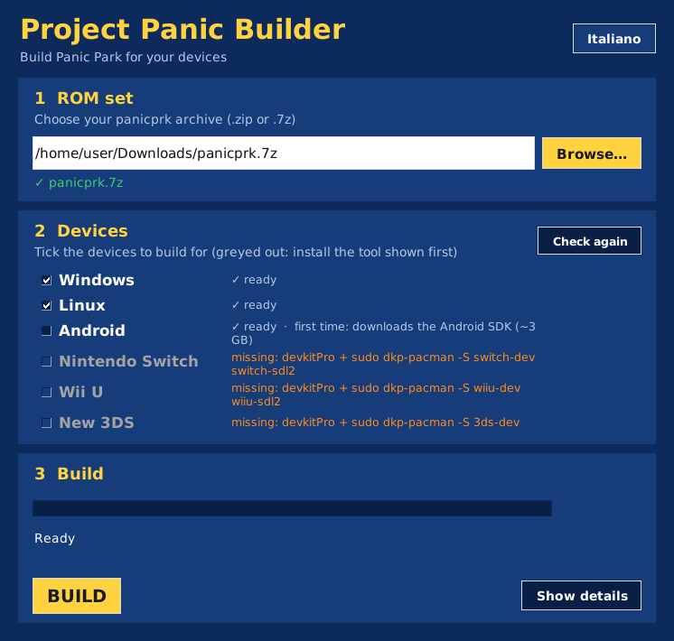
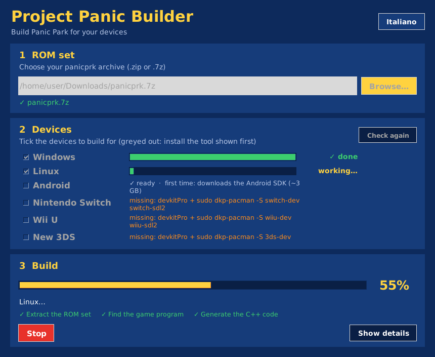
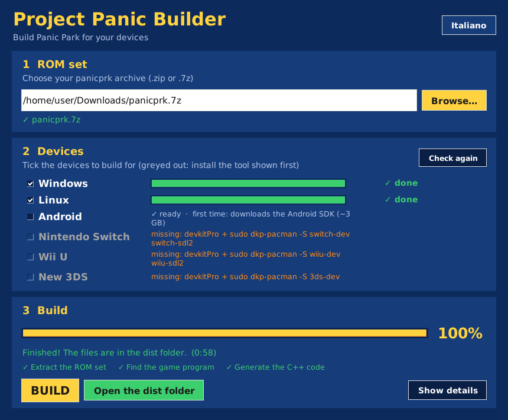

<div align="center">


# Project Panic

**Namco's *Panic Park* (1997, System 23 arcade) as a native program, statically recompiled from MIPS to C++.**


<br>


[Quick start](#-quick-start) · [Manual build](#%EF%B8%8F-manual-build) · [Running](#-running-the-game) · [Controls](#%EF%B8%8F-controls) · [Languages](#-languages)

</div>

---

## ✨ What it is

The game's main program (MIPS R4650) is translated into C++ ahead of time, so it runs at full speed with no CPU
emulation. The rest of the board is emulated: the H8 sub-CPU, the C352 sound chip and the System 23 3D hardware
(drawn by the graphics card, or by the processor).

- 🕹️ Full game at 60 Hz, with sound, keyboard, controllers and touch screens
- 🖥️ Settings menu: controls, video (3D resolution, 16:9, VSync), volume, game language, skip POST
- 🌍 Menu in 9 languages, following the system language
- 🧰 A builder window that does everything from your ROM archive, on Windows and Linux

> [!IMPORTANT]
> **No game code or data is included.** Everything is generated from **your own** Panic Park ROM set (`panicprk.7z`).
> Don't share ROMs, the generated `gen_full/` code, the `assets/` folder or the built programs (`dist/`, which also
> holds copies of your ROM files), and don't post them in issues. Not affiliated with Bandai Namco.

## 🚀 Quick start

`ProjectPanicBuilder.py` does all the steps for you:

1. choose your `panicprk.7z` (or `.zip`),
2. tick the devices,
3. press **BUILD** and follow the percentage. The results end up in `dist/`.

| 1. ROM and devices | 2. Building | 3. Done |
|:---:|:---:|:---:|
|  |  |  |

<details open>
<summary><b>🪟 Windows</b></summary>

1. Install [Python 3](https://www.python.org/downloads/) and tick **"Add python.exe to PATH"**.
2. Double-click `ProjectPanicBuilder.py`.

No WSL needed: the first Windows build downloads the compiler (LLVM-MinGW) by itself.

- **Android**: uses Android Studio if it is installed, otherwise the first build downloads Java and the SDK (~3 GB).
- **Switch, Wii U, 3DS**: install [devkitPro](https://devkitpro.org/wiki/Getting_Started). If packages are missing
  (e.g. `switch-sdl2`, `wiiu-sdl2`), the **Install the missing devkitPro packages** button installs them.
- **Linux** builds need Linux or WSL.

</details>

<details>
<summary><b>🐧 Linux / WSL</b></summary>

```sh
sudo apt install python3-tk p7zip-full
python3 ProjectPanicBuilder.py
```

</details>

Devices whose tools are missing are greyed out, with what to install. If a build fails the window says why, and
**Show details** opens the full log.

## 🛠️ Manual build

<details>
<summary><b>1. Generate the code</b> (all platforms)</summary>

Extract your `panicprk.7z` into a `panicprkrom/` folder inside the project (so that it directly contains
`pnp2vera.ic1`, `pnp2vera.ic2`, `pnp1cgll.4m`, ...), then:

```sh
sudo apt install p7zip-full                  # once, to open .7z files
7z x panicprk.7z -opanicprkrom
python3 tools/extract_rom.py panicprkrom     # -> panicprk_main.elf + main_r4650_BE_4MB.bin
pip install pyelftools
python3 mips2cpp.py --elf panicprk_main.elf --funcs functions.csv --out gen_full
```

`extract_rom.py` joins the two halves of the main program ROM (`pnp2vera.ic2` + `pnp2vera.ic1`) into
`main_r4650_BE_4MB.bin` and takes the game's executable (`panicprk_main.elf`) out of it.

</details>

<details>
<summary><b>2. Build</b> (Linux or WSL)</summary>

| Device | Install once | Build | Output |
|---|---|---|---|
| Linux | `sudo apt install g++ libsdl2-dev` | `sh platform/build_linux.sh` | `dist/linux/` |
| Windows | `sudo apt install g++-mingw-w64-x86-64-posix` | `sh platform/build_windows.sh` | `dist/windows/PanicPark.exe` |
| Android | nothing (Android Studio if installed, otherwise downloads Java + SDK) | `python3 tools/build_android.py` | `dist/android/PanicPark.apk` |
| Switch | [devkitPro](https://devkitpro.org/wiki/Getting_Started) + `sudo dkp-pacman -S switch-dev switch-sdl2` | `sh platform/build_switch.sh` | `dist/switch/sd/` |
| Wii U (Aroma) | devkitPro + `sudo dkp-pacman -S wiiu-dev wiiu-sdl2` | `sh platform/build_wiiu.sh` | `dist/wiiu/sd/` |
| New 3DS | devkitPro + `sudo dkp-pacman -S 3ds-dev` | `sh platform/build_3ds.sh` | `dist/3ds/sd/` |

`bash platform/build_all.sh` builds Windows, Switch, Wii U and Android in one go.

</details>

## 🎮 Running the game

The program needs `panicprk_main.elf`, `main_r4650_BE_4MB.bin` and the `panicprkrom/` folder next to it (the builder
and the build scripts copy them for you).

| Device | How |
|---|---|
| Windows | double-click `PanicPark.exe` |
| Linux | `ROMDIR=panicprkrom ./run.sh` |
| Android | copy the files into the `PanicPark` folder in phone storage (created on the first launch) |
| Switch / Wii U | copy the contents of `dist/<console>/sd/` to the root of the SD card |
| New 3DS | same, plus the `assets/` folder made by the PC version (the builder copies it): see [`3ds/README_3DS.md`](3ds/README_3DS.md) |

## ⌨️ Controls

| Action | Keyboard | Controller |
|---|---|---|
| Move | ← → or A D | D-pad / left stick |
| Button | Z or Space | B |
| Coin | 5 or C | A |
| Start (player 1 / 2) | 1 or Enter / 2 | Start / Y |
| Settings (pause) | Esc | Select + Start |
| Fullscreen | F11 | |
| Test / Service | F2 / F3 | LB / RB |

Everything can be reassigned in **Settings → Controls**. On Switch: A = button, B = coin, X = start 2 (by the labels
printed on the buttons).

## 🌍 Languages

English, Italiano, Deutsch, Français, Español, Português, Русский, 日本語, 简体中文: the game menu and the builder
start in the system language. To add one, copy `platform/lang/en.json` and translate it; if it uses letters the
menu fonts lack, run `python3 tools/bake_ui_font.py` (needs Pillow and `fonts-noto-cjk`).

## 🎨 Icon

The repository has an original icon (`platform/icon_default.png`, no game art) used everywhere. To use another
picture, put it in `platform/ui/icon.png`: like the menu logo and background, it stays on your computer.

## 📜 License

BSD-3-Clause, see [`LICENSE`](LICENSE). Parts derived from [MAME](https://www.mamedev.org/) (H8, C352, System 23).
Fonts: Bangers, Lilita One and Noto Sans CJK (SIL Open Font License, see `platform/fonts/`), DejaVu Sans Mono.
